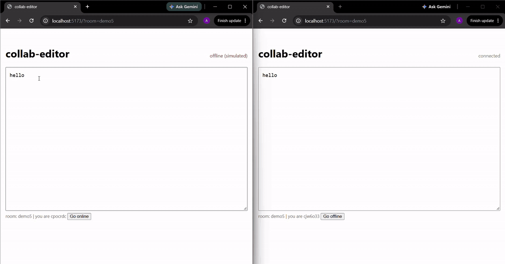

# collab-editor

A real-time collaborative text editor with a **hand-built CRDT**, written in Go and TypeScript.
Edit the same document from multiple browser tabs, go offline, keep typing, and everything merges on reconnect.

## Features

- **RGA CRDT written from scratch** in Go and TypeScript, with tombstones and Lamport-style IDs
- **Conflict-free merging**: concurrent edits converge on every replica, whatever order they arrive in
- **Offline editing**: edits are queued locally and merged on reconnect, with automatic retry and backoff
- **Go WebSocket server** with per-document rooms and full history replay for late joiners
- **Cross-language conformance**: CI regenerates test vectors from the Go code and checks that the TypeScript CRDT produces identical documents

## Performance

Replacing a slice and linear scans with a linked list, an ID index and a cursor "finger" made appending 10,000 characters **36x faster** (125.9 ms to 3.54 ms). Details in [docs/BENCHMARKS.md](docs/BENCHMARKS.md).

## Run it locally

Terminal 1: `cd server`, then `go run .`

Terminal 2: `cd client`, then `npm install`, then `npm run dev`

Open `http://localhost:5173/?room=demo` in two tabs.

## Tests

`cd server && go test ./... -race` and `cd client && npm test`

## Roadmap

- [ ] Acknowledgements and resend for ops lost in flight
- [ ] Persistence (operation log in a database)
- [ ] Load test with 50+ simulated users (p95 latency)
- [ ] Tombstone compaction
